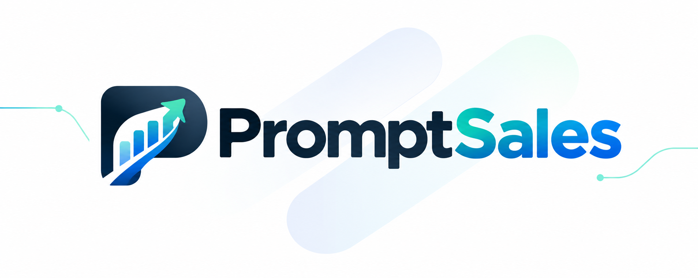
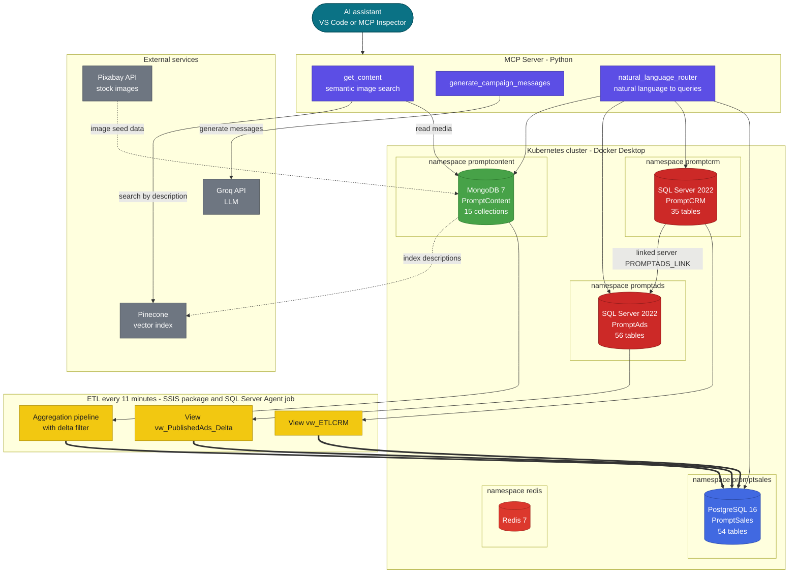

<h1 align="center">PromptSales-Data-Platform</h1>
<p align="center"></p>

<p align="center">
  PromptSales is a consolidated data platform, that includes a polyglot database ecosystem, an AI-powered marketing and sales company: PostgreSQL, SQL Server, MongoDB, and Redis running on Kubernetes, with an ETL pipeline and an MCP server for natural language queries.
</p>

<p align="center">
  
  
  
  
  
  
  
</p>

<p align="center">
  <a href="#project-description">Description</a> ·
  <a href="#technology-stack">Technologies</a> ·
  <a href="#database-design">Database</a> ·
  <a href="#architecture">Architecture</a> ·
  <a href="#installation">Installation</a> ·
  <a href="#license">License</a>
</p>

---

## Authors

- Dylan Chacón Berrocal, 2023171126
- Christopher Daniel Vargas Villalta, 2024108443
- Miguel Eduardo Aguero Mata, 2020100846
- Luan Chaves Bermudez, 2019157253
- Lindsay Marín Sánchez, 2024163904

#### Professor

- Rodrigo Nuñez Nuñez

---

## Project Description

SolidNY is a company based in New York with 15 years of experience in digital marketing. With the purpose of expanding its reach and taking advantage of the potential of artificial intelligence, the company launches a new brand called PromptSales, whose focus is to close sales efficiently and measurably. Its main success criterion lies in the number and amount of sales achieved, using a combination of automation, data analysis, and artificial intelligence applied to every stage of the sales funnel.

PromptSales is made up of an ecosystem of interconnected sub-companies, each specialized in a different stage of the marketing and sales process. Although they can operate independently, they all integrate into an automated flow that covers everything from content creation to closing sales.

The sub-companies are:

### PromptContent

- It is in charge of generating creative content for marketing campaigns. Its products and services include:

- Creation of text, audiovisual content, and images for social networks, ads, and websites.
- Generation of material adaptable to search engine results and artificial intelligence answers.
- Use of its own AI tools for the automated creation of content optimized for different target audiences.
- Integration with external platforms such as Canva, Adobe, Meta Business Suite, the OpenAI API, etc.

### PromptAds

- Responsible for running and optimizing advertising campaigns.

- Design, segmentation, and publishing of ads on social networks, email marketing, SMS, LinkedIn, and influencers.
- Real-time analysis of campaign performance.
- Automatic generation of campaigns from target audience data and sales goals.
- Integration with external platforms such as Google Ads, Meta Ads, TikTok for Business, Mailchimp, and CRM platforms.

### PromptCrm

- Manages the follow-up of potential customers until the sale is closed.

- Automatic registration and classification of leads coming from different sources.
- Implementation of chatbots, voicebots, and automated support flows.
- Follow-up of buyers and prediction of purchase intent through AI.
- Integration with platforms such as HubSpot, Salesforce, Zendesk, WhatsApp Business API, among others.

---

## Technology Stack

Different technologies were used to build the project, such as relational databases (SQL Server, PostgreSQL) and non-relational databases (MongoDB).

MCP Servers were implemented to connect to the databases and run queries directly through natural language.

The descriptions of the media files stored in PromptContent were indexed with Pinecone, so that fast AI-powered searches could be run through the MCPs.

Microsoft Integration Services was also used to build an ETL (Extract, Transform, Load) in PromptSales that gathers the information stored in the other databases (CRM, ADS, etc.) so it can be analyzed and used to generate reports.

- **Databases:** PostgreSQL 16 (PromptSales), SQL Server 2022 (PromptAds and PromptCrm), MongoDB 7 (PromptContent), and Redis 7.
- **ETL:** SQL Server Integration Services (SSIS) and SQL Server Agent.
- **Infrastructure:** Docker Desktop and Kubernetes (namespaces, secrets, deployments, persistent volume claims, and NodePort services).
- **MCP server:** Python with the `mcp` SDK, `pymongo`, `pyodbc`, `asyncpg`, and `psycopg2`.
- **AI and search:** Pinecone (vector search), Groq API (LLM), and Pixabay API (sample images).
- **Tools:** SQL Server Management Studio, pgAdmin 4, MongoDB Compass, Redis Insight, Visual Studio, and VS Code.

---

## Database Design

### PromptSales

- [PromptSales](BasesDeDatos/PromptSales/Disenos "Database design")

- [PromptContent](BasesDeDatos/PromptContent/Disenos "Database design")

- [PromptCrm](BasesDeDatos/PromptCRM/Disenos "Database design")

- [PromptAds](BasesDeDatos/PromptAds/Disenos "Database design")

| Database | Engine | Size | Highlights |
|----------|--------|------|------------|
| **PromptSales** | PostgreSQL 16 | 54 tables | Consolidated data warehouse that receives the data of the other sub-companies through the ETL, for analysis and reports. |
| **PromptContent** | MongoDB 7 | 15 collections | Users, clients, media, campaigns, AI models, external services, API call logs, and subscriptions and payments. Image descriptions are indexed in Pinecone. |
| **PromptAds** | SQL Server 2022 | 56 tables | Stored procedure that inserts a full campaign with table-valued parameters, analysis of negative and positive campaigns, and `INTERSECT`, `EXCEPT`, and `MERGE` queries. |
| **PromptCrm** | SQL Server 2022 | 35 tables | Concurrency problem demos (cascade deadlock, dirty read, incorrect summary), AES-256 encryption with a certificate and a symmetric key, and a linked server to PromptAds. |
| **Redis** | Redis 7 | - | Deployed in Kubernetes as part of the environment. |

---

## Architecture

Every database runs in its own Kubernetes namespace. An ETL job consolidates the data of PromptContent, PromptAds, and PromptCrm into PromptSales, and an MCP server lets an AI assistant query the databases and search media in natural language.



Thick arrows are the ETL load into PromptSales, solid arrows are runtime queries, and dotted arrows are the data preparation scripts.

| Component | Description |
|-----------|-------------|
| **Kubernetes environment** | Namespaces, secrets, and one deployment, persistent volume claim, and service per database (Redis uses a config map instead). The databases are exposed through NodePorts: PostgreSQL `30432`, MongoDB `30017`, SQL Server PromptAds `31433`, SQL Server PromptCRM `32433`, and Redis `30379`. |
| **ETL** | An SSIS package, scheduled by a SQL Server Agent job every 11 minutes, loads only the new or modified data (delta) from PromptContent, PromptAds, and PromptCrm into PromptSales. |
| **MCP server** | Python server with connectors for PostgreSQL, MongoDB, and SQL Server. It exposes three tools: `get_content` (semantic search of images with Pinecone), `generate_campaign_messages` (campaign messages by audience with an LLM), and `natural_language_router` (natural language requests to the databases). |
| **Security and concurrency** | PromptCrm includes AES-256 encryption with a certificate and a symmetric key, and scripts that reproduce concurrency problems. |

---

## Project Structure

```text
PromptSales-Data-Platform/
├── BasesDeDatos/
│   ├── PromptSales/           # PostgreSQL: designs, creation scripts, ETL (SSIS), and SQL Server Agent job
│   ├── PromptContent/         # MongoDB: collections, data generation, and Pinecone indexing scripts (Python)
│   ├── PromptAds/             # SQL Server: creation, inserts, stored procedures, and delta view
│   ├── PromptCRM/             # SQL Server: creation, inserts, concurrency, encryption, and linked server
│   ├── Redis/                 # Redis (deployed in Kubernetes)
│   └── DiseñosBD.md           # Schemas of the PromptContent collections
├── kubernetes/
│   ├── namespaces/            # One namespace per database
│   ├── secrets/               # Secrets of each database (passwords taken from .env)
│   ├── databases/             # Deployment, PVC, and service of each database
│   └── scripts/               # deploy-all.ps1, delete-all.ps1, and status-check.ps1
├── mcp-server/                # MCP server (Python): connectors, configuration, and tools
├── Investigacion y Documentacion/
│   ├── Investigacion.md       # Research
│   ├── Documentacion.md       # Project documentation
│   └── Bitacora.md            # Logbook
├── docs/images/               # README images (logo)
├── .env.example               # Template of the environment variables (passwords and API keys)
├── requirements.txt
├── LICENSE
└── README.md
```

---

## Installation

### Prerequisites

- Docker Desktop with Kubernetes enabled, and `kubectl`
- Python 3.10 or newer
- A SQL Server client (SSMS or `sqlcmd`), pgAdmin or `psql`, and MongoDB Compass (optional)
- Visual Studio with the SQL Server Integration Services extension (only to open the ETL)
- Pinecone and Groq API keys (only for the MCP server and the PromptContent scripts)

1. Copy `.env.example` as `.env` in the repository root and fill in the database passwords and the API keys (the `.env` file is ignored by Git):
   ```powershell
   Copy-Item .env.example .env
   ```
2. Deploy the databases in Kubernetes from the repository root. `deploy-all.ps1` takes the passwords from `.env` to create the Kubernetes secrets:
   ```powershell
   ./kubernetes/scripts/deploy-all.ps1
   ./kubernetes/scripts/status-check.ps1
   ```
   To remove everything, run `./kubernetes/scripts/delete-all.ps1`.
3. Create and populate each database (see the `Scripts` folder of each one):
   - **PromptSales:** `BasesDeDatos/PromptSales/Scripts/CreationPromptSales.sql`, then `LlenadoSales.sql`.
   - **PromptAds:** `BasesDeDatos/PromptAds/Scripts/CreationPromptAds.sql`, then `InsertsPromptAds.sql` and the stored procedure scripts.
   - **PromptCrm:** `BasesDeDatos/PromptCRM/Scripts/PromptCRM_CreationScript.sql`, then `InsertClients.sql`, `InsertSales.sql`, `InsertUTMs.sql`, and `Views.sql`.
   - **PromptContent:** run the Python scripts in `BasesDeDatos/PromptContent/Scripts/` in order: `001-creacion-colecciones.py`, `002-generar-100-imagenes.py`, `0003-llenado-colecciones.py`, `004-indexación-descripciones-pinecone.py`, and `005-registrar-groq-servicio.py`.
4. Install the Python dependencies:
   ```bash
   pip install -r requirements.txt
   ```
5. Start the MCP server in inspector mode:
   ```bash
   cd mcp-server
   mcp-inspector --config mcp-config.json
   ```
   It can also be started from VS Code with `mcp-server/.vscode/mcp.json`.
6. To run the ETL, open `BasesDeDatos/PromptSales/Scripts/PromptSalesETL/PromptSalesETL.sln` in Visual Studio, configure the connections, and run `BasesDeDatos/PromptSales/Scripts/Job11.sql` to schedule the job.

### Notes

- The passwords and API keys live only in the `.env` file. `kubernetes/secrets/all-secrets.yaml` and `mcp-server/config/databases.yaml` reference them as `${VARIABLE}`, and the PromptContent scripts read `MONGO_URL` from it. Use `.env.example` as the template.
- The project documentation in `Investigacion y Documentacion/`.

---

## License

Distributed under the MIT License. See [`LICENSE`](LICENSE) for details.
